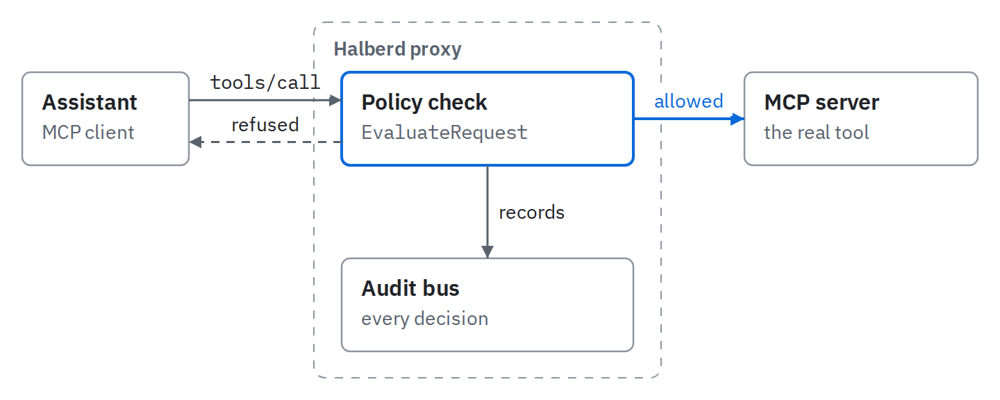
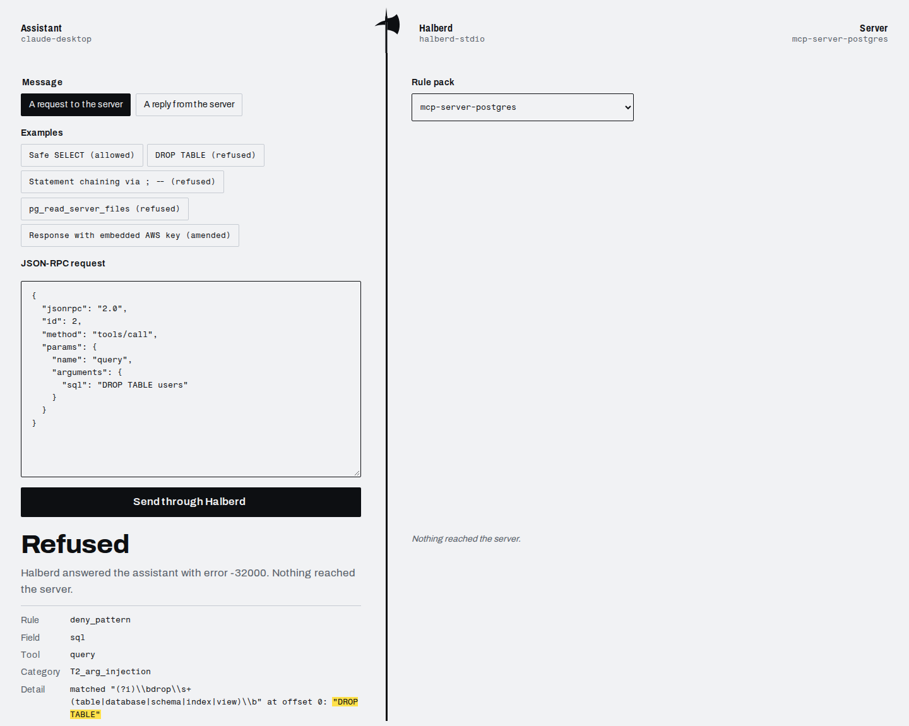
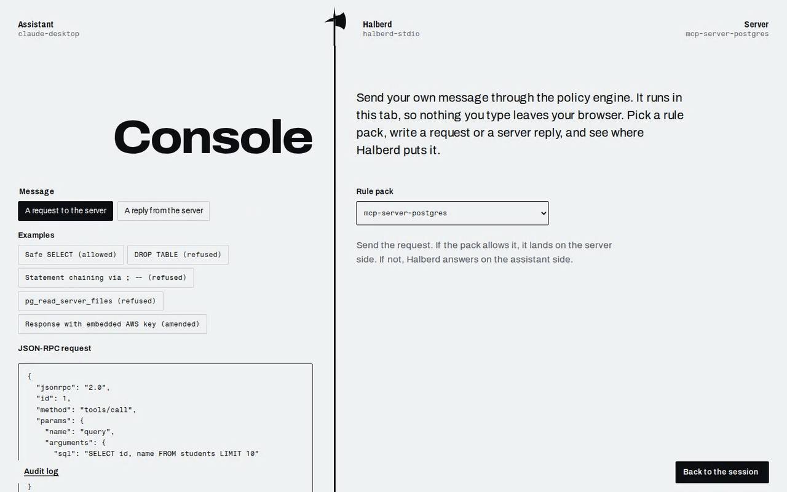

<picture>
  <source media="(max-width: 600px) and (prefers-color-scheme: dark)" srcset="assets/banner-mobile-dark.svg">
  <source media="(max-width: 600px)" srcset="assets/banner-mobile-light.svg">
  <source media="(prefers-color-scheme: dark)"  srcset="assets/banner-dark.svg">
  <source media="(prefers-color-scheme: light)" srcset="assets/banner-light.svg">
  
</picture>

[](https://github.com/Builder106/halberd/actions/workflows/ci.yml)
[](https://go.dev/)
[](#license)
[](https://modelcontextprotocol.io)
[](https://halberd-keep.vercel.app)

> **Useful access, with limits you choose.** Halberd checks an AI assistant's tool requests against your policies before letting them through.

## What is Halberd?

You ask an AI assistant to look up ten student records. So far, so useful. But the same database tool can receive a command to erase an entire table. Who checks which request gets through?

Halberd sits between the assistant and its connected tools. You choose the rules: which tools are permitted, which commands are forbidden, and which sensitive values should be removed from responses. Halberd applies those rules as requests and responses pass through it.

## One tool, two outcomes

Every tool call is checked before it leaves the proxy. A refused call never reaches the MCP server.

<picture>
  <source media="(prefers-color-scheme: dark)" srcset="assets/diagrams/policy-check-dark.png">
  
</picture>

[Edit the diagram](assets/diagrams/policy-check.html).

Here are two requests checked against the bundled PostgreSQL policy. `SELECT id, name FROM students LIMIT 10` reaches the database tool unchanged. `DROP TABLE students` matches a forbidden-command pattern, so the assistant receives an error instead. Both decisions are sent to the audit bus for recording.

<details>
<summary><strong>Developer details</strong></summary>

Halberd is a reverse proxy for the Model Context Protocol (MCP), the protocol AI assistants use to call connected tools. It supports HTTP and local stdio transports.

- The [PostgreSQL bundle](policies/mcp-server-postgres.yaml) declares the `query` tool, a string-valued `sql` argument, an 8,192-byte limit, and forbidden SQL patterns.
- The [policy engine](internal/policy/engine.go) checks the tool and arguments. A matched pattern produces a `deny_pattern` violation.
- The [HTTP proxy](internal/transport/http/proxy.go) records the decision, then either forwards the request body unchanged or returns JSON-RPC error `-32000` to the assistant. That protocol error travels inside an HTTP `200` response.
- Response filtering is a separate step. Configured filters remove escape sequences and redact recognized secret patterns in JSON-RPC results, including HTTP event streams.

These decisions come from the configured rules. Halberd does not create an operating-system sandbox. See the [firewall architecture](docs/FIREWALL_ARCHITECTURE.md) for the enforcement boundaries and the [policy DSL](docs/policy-dsl.md) to write your own rules.

</details>

**Try the same requests:** [Open the console](https://halberd-keep.vercel.app/console), choose the PostgreSQL pack, and compare the two queries. The console runs the Go policy engine in your browser through WebAssembly, so you can inspect a decision without installing the proxy.

<details>
<summary><strong>Watch it work</strong></summary>

<a href="https://halberd-keep.vercel.app/console">
  
</a>

Every challenge resolves to one of three protocol verdicts:

| Verdict | Disposition | Client response |
| --- | --- | --- |
| **Refused** | Blocked | Synthetic JSON-RPC error (`-32000`) before reaching upstream |
| **Allowed** | Forwarded | Request forwarded to upstream tool server unchanged |
| **Amended** | Sanitized | Response rewritten to redact secrets and strip control characters |

### See it in motion

A `DROP TABLE` under the PostgreSQL pack, refused before forwarding:


<sub><a href="assets/demo/refused-drop-table.mp4">Watch the MP4 version</a>.</sub>

<details>
<summary><strong>Refused:</strong> path traversal attempt stopped by the filesystem pack</summary>



<sub>mp4: <a href="assets/demo/refused-path-traversal.mp4">refused-path-traversal.mp4</a></sub>

</details>

<details>
<summary><strong>Amended:</strong> recognized secrets redacted from a tool reply</summary>


<sub>mp4: <a href="assets/demo/amended-aws-github-rsa-laden-response.mp4">amended-aws-github-rsa-laden-response.mp4</a></sub>

</details>

<details>
<summary><strong>Allowed:</strong> a safe database query passes unchanged</summary>


<sub>mp4: <a href="assets/demo/granted-safe-select.mp4">granted-safe-select.mp4</a></sub>

</details>

</details>

## Why this exists

An assistant's tools can read files, run queries, and return data that influences its next action. These are the threats Halberd's policies address, including the I/O controls still on the roadmap:

| # | Threat | What happens |
| --- | --- | --- |
| T1 | Tool poisoning | A compromised tool server returns hidden commands designed to hijack the AI's next action |
| T2 | Argument injection | An attacker tricks the AI into running destructive commands (such as deleting database tables or running dangerous shell scripts) |
| T3 | Unauthorized file access | A tool attempts to read private system files or access restricted networks |
| T4 | Permission creep | A connected server silently introduces new, unvetted tools in the middle of an active session |
| T5 | Secret exfiltration | A tool response accidentally leaks API keys, passwords, or encryption keys back to the AI model |

Halberd checks configured T2 rules, denies undeclared tools (T4), and can strip control characters and recognized secrets from tool results (parts of T1 and T5). It does not detect general prompt injection, enforce a filesystem or network sandbox (T3), or guarantee that every secret format is recognized.

## Install

There is no published binary release yet. To try Halberd, install Go 1.26 or later and build from source:

```bash
git clone https://github.com/Builder106/halberd && cd halberd
go build -o bin/ ./cmd/...
./bin/halberd lint policies/mcp-server-postgres.yaml
```

## Bundled rule packs

| Pack | Checks | Note |
| --- | --- | --- |
| [`mcp-server-postgres.yaml`](policies/mcp-server-postgres.yaml) | Denies listed SQL patterns and scans results for recognized secrets | Review it against your database permissions; it is not a read-only SQL policy |
| [`mcp-server-filesystem.yaml`](policies/mcp-server-filesystem.yaml) | Denies listed path patterns and scans returned text for recognized secrets | Array-arg tools (`read_multiple_files`, `edit_file`) are denied; the rules do not resolve symlinks or enforce a filesystem root |
| [`mcp-server-git.yaml`](policies/mcp-server-git.yaml) | T2 (`--upload-pack=…`-style long-opt smuggling in ref/branch names; path traversal in `repo_path`), T5 | State-mutating tools (`commit`, `add`, `reset`, `init`) denied by default |
| [`mcp-server-github.yaml`](policies/mcp-server-github.yaml) | Checks configured owner values, repo-name patterns, and response secrets | **Edit `your-org` before use.** Destructive tools such as `delete_repository` and `transfer_repository` are not listed |
| [`halberd-honeypot.yaml`](policies/halberd-honeypot.yaml) | Demo cases for denied inputs and secret redaction | Matched bundle for [`cmd/halberd-honeypot`](cmd/halberd-honeypot/); demo-only |

### Try it against the honeypot

Halberd ships with a deliberately-vulnerable MCP server,
[`cmd/halberd-honeypot`](cmd/halberd-honeypot/), whose tool outputs
are the threats themselves. Pair it with `halberd-stdio` and the
matched bundle for a one-command end-to-end demo:

```bash
go build -o bin/ ./cmd/...

bin/halberd-stdio \
  --policy policies/halberd-honeypot.yaml \
  --audit  halberd.jsonl \
  -- bin/halberd-honeypot
```

Pipe in a `tools/call` for `execute_sql` with `DROP TABLE`, or `read_file`
with `../../etc/passwd`, or `list_users` (the response carries fake
AWS / GitHub / RSA secrets) — and watch Halberd block, redact, and audit
each one. See [`cmd/halberd-honeypot/README.md`](cmd/halberd-honeypot/README.md)
for the full threat-coverage table.

<details>
<summary><strong>▶ Watch it run</strong> — 30s terminal cast: DROP TABLE refused, secrets redacted, audit log captured</summary>


<sub><a href="assets/honeypot-demo.mp4">Watch the MP4 version</a>.</sub>

</details>

### Option A — remote MCP server (HTTP transport)

```bash
./bin/halberd-http \
  --policy policies/mcp-server-postgres.yaml \
  --target http://localhost:8080 \
  --listen 127.0.0.1:9090 \
  --audit  halberd.jsonl
```

Point your MCP client at `http://127.0.0.1:9090` instead of the postgres
server. Halberd queues each `tools/call` decision for the audit log and
reports dropped events if the queue fills. Try a `DROP TABLE` — Halberd
returns a JSON-RPC error before the request reaches postgres.

The listener binds to loopback by default. Requests carrying a cross-origin `Origin` header are rejected. If you bind it to a network interface, protect access at the network boundary; Halberd has no client authentication.

### Option B — local stdio server (Claude Desktop, Cursor, Windsurf)

Drop `halberd-stdio` into the host's MCP server config in place of the
real server command. For Claude Desktop, edit
`~/Library/Application Support/Claude/claude_desktop_config.json`:

```json
{
  "mcpServers": {
    "postgres": {
      "command": "/usr/local/bin/halberd-stdio",
      "args": [
        "--policy", "/etc/halberd/postgres.yaml",
        "--audit",  "/var/log/halberd/postgres.jsonl",
        "--",
        "mcp-server-postgres", "--conn-string", "postgresql://..."
      ]
    }
  }
}
```

Restart Claude Desktop. Every JSON-RPC message between Claude and
`mcp-server-postgres` now flows through Halberd. Argument-injection
attempts (`DROP TABLE`, statement chaining via `; --`, etc.) come back
to Claude as JSON-RPC errors that the model can reason about, and the
upstream server never sees the blocked payload.

## Policy DSL

```yaml
version: 1
server: mcp-server-postgres
tools:

  - name: query

    arguments:
      sql:
        type: string
        max_length: 8192
        deny_patterns:

          - '(?i)\bdrop\s+(table|database|schema)\b'
          - ';\s*--'                                  # statement chaining

defaults:
  unknown_tool: deny           # T4: block tools not in this bundle
  unknown_method: log_and_pass
```

Full reference: [docs/policy-dsl.md](docs/policy-dsl.md).

## Roadmap

| Phase | Status | Outcome |
| --- | --- | --- |
| **P1** — HTTP reverse proxy + audit bus | implemented | `halberd-http` forwards JSON-RPC and logs request decisions |
| **P2** — Policy engine, deny-pattern blocking, T2 + T4 coverage | implemented | YAML bundles, regex denylist, unknown-tool guard |
| **P3** — stdio transport | implemented | `halberd-stdio` wraps local MCP servers over line-delimited JSON-RPC |
| **P4** — Response inspection | implemented | Inspect JSON-RPC result strings, including SSE events; strip selected control characters and redact recognized AWS, GitHub, and private-key formats |
| **P5** — Rule packs + hardening | implemented | Bundles for `mcp-server-{filesystem,git,github,postgres}` and per-pack tests |

## Performance

CI records policy-engine benchmarks, but does not enforce a latency or throughput limit. Run `go test -bench=. -benchmem ./internal/policy` to measure your build and hardware.

## Architecture

- [`cmd/halberd-http`](cmd/halberd-http/main.go) — the reverse-proxy binary
- [`cmd/halberd-stdio`](cmd/halberd-stdio/main.go) — the stdio MITM wrapper binary
- [`cmd/halberd`](cmd/halberd/main.go) — operator CLI (`halberd lint …`)
- [`cmd/halberd-honeypot`](cmd/halberd-honeypot/) — deliberately-vulnerable MCP server for demos and integration tests
- [`internal/policy`](internal/policy/) — IO-free policy engine
- [`internal/jsonrpc`](internal/jsonrpc/) — JSON-RPC 2.0 envelope + error synthesis
- [`internal/audit`](internal/audit/) — non-blocking audit bus → JSONL
- [`internal/transport/http`](internal/transport/http/) — `httputil.ReverseProxy` wrapper
- [`internal/transport/stdio`](internal/transport/stdio/) — bidirectional JSON-RPC pipe with policy MITM
- [`policies/`](policies/) — rule packs (data, not code)

## Related work

- **[`mcp-scan`](https://github.com/invariantlabs-ai/mcp-scan)** — static

  analysis of MCP server source. Complementary to Halberd (static vs.
  runtime).

- **Cloudflare AI Gateway / Portkey** — LLM-side proxies, inspect prompts and

  completions, not tool-call envelopes. Different layer.

- **Microsoft RAMPART** — fuzzing harness for agentic security testing.

  Test-time, not prod-time.

## Contributing

See [CONTRIBUTING.md](CONTRIBUTING.md). The "out of scope" list near the
bottom is worth reading before opening a PR.

## License

MIT. See [LICENSE](LICENSE).
